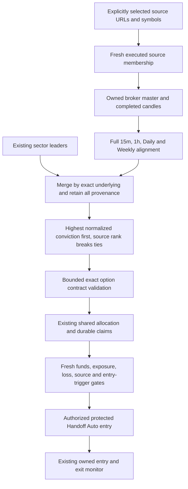

# Selected Screeners in FYERS Analysis Handoff

The authenticated FYERS workspace owns `handoff-screener.sqlite3` beside its existing Handoff schedule. The user explicitly authorized adding their last submitted Screener analysis universe to Handoff and existing Auto Live mode. Initial binding retains 134 explicitly selected symbols and the one observed configured Chartink source, Pinaki - Bollinger Band Squeeze. Current membership is intersected with that selection: new source members are not silently adopted. Future selections are explicit in the Screener panel; Handoff provides separate analysis/Auto-inclusion controls. These do not change schedule enablement, mode, capital, loss cutoff, product choice, consent or session. Other brokers/accounts are not implicitly enabled; missing Handoff/Screener permission fails closed.

Source refresh requires executed JSON rows, complete declared row count and an allowlisted exact Chartink URL. It never interprets page-text stock mentions as membership or replays old selections as live results. A transient incomplete response receives one read-only retry, then becomes unavailable. Source failure blocks combined Auto ranking. Valid zero-result scans remain explicit and can leave sector-only opportunities. Source membership is cached for at most five minutes and rechecked before execution. Clearing/changing the selection invalidates new Screener intents. Existing broker orders/exits continue their existing management; this setting does not cancel broker orders.

All selected current members are analyzed. There is no silent first-12 equity truncation. Broker timeframe evidence is persisted per selection revision and completed-bar window; partial/cancelled scans checkpoint progress and resume from valid evidence after restart. A recent owned dedicated Screener job may supply indicator evidence only when its exact four broker timeframes pass the same timestamp/quality checks. Old decisions, prices, targets, quantities and orders are never imported. Unknown/missing/stale evidence is excluded. Closed-session research requires last-session intraday bars near the close and remains report-only. Public cached evidence is retained for two days; progress summaries for seven days. Broker requests use the existing paced provider. Option-chain construction remains bounded to 12 highest-ranked qualified underlyings, with deferred symbols explicit.

Handoff rebuilds plans and protection from selected-broker evidence. Rule mode makes no AI/fundamental calls. Selected Codex ChatGPT mode uses the existing AI path and company-filings feedback; Auto requires its directional affirmation and withholds WAIT/unavailable/conflicting AI results. Fundamentals remain report-only and never alter risk limits or accepted protection.

The same normalized-conviction and recorded-source-rank key orders cards, option validation, top-five allocation and execution consideration. One underlying can carry multiple sector/screener labels but only one plan is chosen. Execution fingerprint excludes source names/report prose, preserving duplicate suppression across sources and restarts. The existing shared claims reserve at most the authorized INR100000 pool and retain uncertain/open ownership. The INR10000 daily loss cutoff, exact master/lot/tick, no-position/pending duplicate checks, entry condition, accepted stop/target and monitor remain required. Any scan that exceeds its schedule slot is saved for diagnostics and never submitted from historical evidence.

There is one execution owner for selected names while this Handoff Auto integration is enabled: separate Screener or manual Handoff batch/single submissions for those selected underlyings are blocked. The native Handoff ticket worker can submit only after validating its durable receipt and reserved claim. Users can remove source ownership or switch Handoff to Manual before using the separate reviewed batch workflow. No raw Screener row can directly call Auto submission.

Live and saved Handoff reports show source labels, scope counts, merged duplicates and explicit exclusions. The Review merged evidence action runs the normal durable analysis path with its intermediate/report-only marker; it cannot submit orders and is excluded from the notification publisher. The UI never saves on page load; source changes require explicit actions and matching selected account. It preserves local Screener configurations and manual selections. No test Live order is used for verification.

Activation requires the owning FYERS dashboard and notification-sidecar modules to reload. The sidecar retains its real signed-in session binding only in memory, so its necessary restart requires the owner to click Save schedule once with existing settings. No session is minted, credential copied into chat, or Auto consent changed to bypass that requirement.
